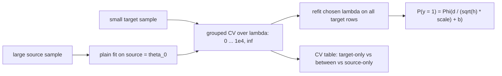
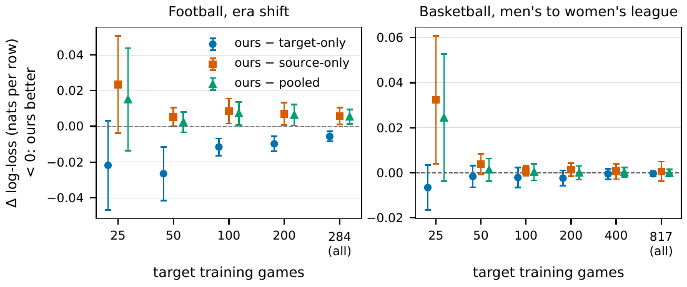
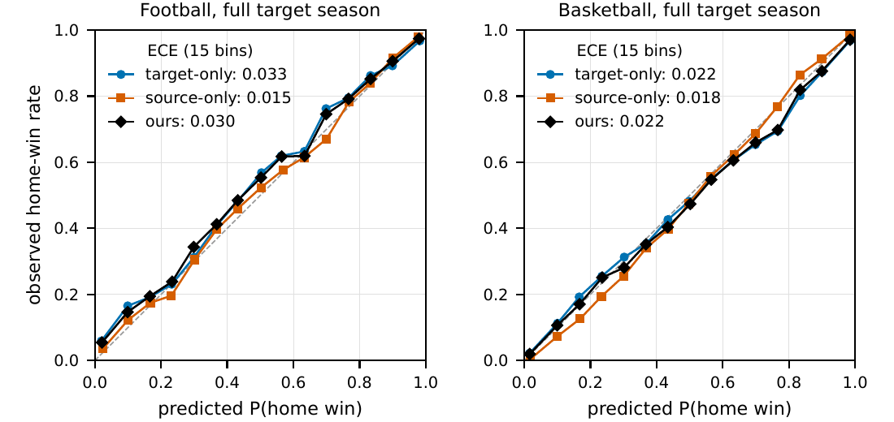
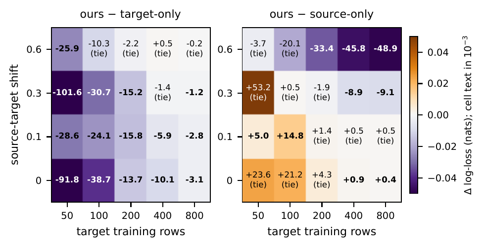

# scaleprobit: a probit with a learned noise scale, transferred from a big sample to a small one

<p align="center">
  <a href="https://x.com/tr4m0ryp"></a>
</p>
<p align="center">
  <a href="paper/scaleprobit.pdf"></a>
</p>

Pulling a heteroscedastic probit's ridge towards a fit on a large related sample, instead of towards zero, beat the
plain target-only fit by **0.027 nats per row (SE 0.008) at 50 target games** on a public football era shift and
beyond SE in **15 of 20** synthetic regimes. The gain comes from the **source fit**, not from adapting to the target:
on both real tasks, simply using the source fit unchanged was as good or better, and the tables below say so.

```bash
pip install git+https://github.com/tr4m0ryp/scaleprobit
```

```python
from scaleprobit import ScaleProbitTransferCV, fit_source
prior = fit_source(X_src, y_src, distance=d_src, horizon=h_src)            # large related sample, fitted once
model = ScaleProbitTransferCV(prior=prior).fit(X, y, distance=d, horizon=h, groups=g)  # small target
p = model.predict_proba(X_new, distance=d_new, horizon=h_new)[:, 1]
print(model.lam_, model.cv_results_["role"], model.cv_results_["mean_test_log_loss"])  # did adapting pay?
```

<details>
<summary>How the model works, in plain words</summary>

Picture a football game with five minutes left and the home team up by seven. Will they still be ahead at the end?
The score will keep moving until the clock runs out. A good first guess treats that movement like a random walk: the
further ahead you are, and the less time is left, the safer the lead. That gives a simple formula, the normal curve
evaluated at "lead divided by how much the score can still move". It is about 30 years old and it works well.

Its weak spot is the "how much can still move" part, the **scale**. A random walk assumes the score wobbles by the same
amount in every game. Real games do not. A high-scoring matchup swings more, a team out of timeouts swings less, a
blowout slows down. So this package lets the scale depend on features: the scale is the old constant times
`exp(a + w . z)`, where `z` are a few standardised features and `a`, `w` are learned. When `a`, `w` and a small bias `b`
are all zero, you get the old formula back exactly. That makes it a **heteroscedastic probit**: a probit whose noise
size changes from row to row.

The model works on yes/no outcomes of the same shape as the game: a running total that still drifts, read off once
when time is up, such as a final score margin, a season's rainfall against its average, or a project's hours against
its budget. You give it how far the total is from the mark now, how much time is left, and features that should make
the drift bigger or smaller.

Learning the scale well takes data. With only a few hundred rows, the coefficients `a` and `w` are noisy. The usual
fix is a ridge penalty, which shrinks them towards zero. But zero means "back to the old formula", and you often know
better than that.

Often you have a much bigger related sample: earlier seasons, a neighbouring league, last year's product. This
package fits the model on that **source** sample first. Then, on the small **target** sample, it shrinks towards the
source fit instead of towards zero. Think of a new employee who starts from the senior colleague's habits and only
changes them where the new job clearly differs.

How hard to pull towards the source is a single number, `lambda`. It is chosen by cross-validation on the target,
with folds that keep related rows together (all rows of one game). The grid always includes the two extremes:
`lambda = 0` ignores the source and fits the target alone, `lambda = infinity` uses the source fit unchanged. The
output table therefore tells you directly which of the three won: target alone, source alone, or something between.

What we found: the pull towards the source beats the plain target fit on football from 50 games on and in 15 of 20
synthetic cells, and ties it on basketball. That gain comes from the source fit: on our two real datasets, using the
source fit unchanged was at least as good, and cross-validation on a few dozen games cannot always tell a real
difference between source and target from noise.



</details>

## The method

For row $`i`$ with signed distance $`d_i`$ to the threshold, horizon $`h_i > 0`$, base scale $`s_i > 0`$ and scale
features $`z_i`$ (the log of positive features, standardised with the **source** mean and sd):

```math
\sigma_i = s_i \exp(a + w^\top z_i), \qquad
\eta_i = \frac{d_i}{\sqrt{h_i}\,\sigma_i} + b, \qquad
P(y_i = 1) = F\big(\mathrm{clip}(\eta_i, -c, c)\big)
```

$`F`$ is the standard normal CDF (or a Student-$`t`$ CDF), $`c = 12`$. With $`\theta = (a, w, b) = 0`$ this is the
Brownian closed form $`\Phi(d / (s\sqrt{h}))`$ (Stern 1994). The plain variant shrinks towards zero with $`a`$ free;
the transfer variant shrinks every coordinate, $`a`$ included, towards the source fit $`\theta_0`$:

```math
\hat\theta_{\text{plain}}(\lambda) = \arg\min_\theta\ \ell_T(\theta) + \tfrac{\lambda}{2}\big(\lVert w\rVert^2 + b^2\big),
\qquad
\hat\theta(\lambda) = \arg\min_\theta\ \ell_T(\theta) + \tfrac{\lambda}{2}\lVert \theta - \theta_0\rVert^2
```

$`\ell_T`$ is the summed negative log-likelihood on the target rows. $`\lambda`$ is picked by grouped 5-fold CV over
$`\{0, 1, 10, 100, 10^3, 10^4, \infty\}`$, ties to the larger value; $`\lambda = \infty`$ returns $`\theta_0`$ exactly
(source-only) and $`\lambda = 0`$ is the unpenalised target fit (target-only). The fit is L-BFGS-B with an analytic
gradient and boxes $`|a| \le 1.5`$, $`|w_j|, |b| \le 2`$.

A ridge centred at an old fit is not new: it is MAP adaptation (Chelba and Acero 2006), biased regularisation
(Kuzborskij and Orabona 2013) and L2-SP (Li et al. 2018). The delta here is narrow: the heteroscedastic probit with a
penalised scale intercept, a frozen source standardisation, and both endpoints on the CV grid. In the quadratic
regime, with Fisher information $`J`$ from $`n`$ target rows and gap $`\delta = \theta_0 - \theta_*`$, the expected
excess risk has

```math
R'(0) = -\frac{2}{n}\,\mathrm{tr}\big(J^{-1}\Lambda\big) < 0, \qquad
\lim_{\lambda\to\infty} R(\lambda) = \delta^\top \tfrac{J}{n}\,\delta
```

so a small pull always helps in expectation; whether CV finds it on a few dozen groups is an empirical question. The
proof is in the [paper](paper/scaleprobit.pdf), Appendix A.

## Results

Two public tasks and a synthetic map. **Football**: play-by-play, source seasons 2009-2017 (2,398 games), target
season 2021 (284 games), test seasons 2022-2024 (852 games), an era shift. **Basketball**: source men's league
2019-2024 (7,565 games), target women's league 2019-2022 (817 games), test 2023-2025 (838 games). 20 random game
states per game, $`y = 1`$ when the home team wins. Held-out log-loss in nats per row; ours minus arm with a paired SE
(block bootstrap over test games, 2,000 draws, plus the spread over 20 target subsamples); negative favours ours.

**Full target season:**

| arm | football log-loss | ours - arm (SE) | basketball log-loss | ours - arm (SE) |
|---|---|---|---|---|
| closed form ($`\theta = 0`$) | 0.4908 | **-0.0202 (0.0054)** | 0.4732 | -0.0016 (0.0028) |
| target-only (plain, CV) | 0.4762 | **-0.0056 (0.0014)** | 0.4719 | -0.0004 (0.0006) |
| source-only ($`\lambda = \infty`$) | 0.4648 | +0.0058 (0.0025) | 0.4709 | +0.0006 (0.0022) |
| pooled, domain term in the scale | 0.4652 | +0.0054 (0.0021) | 0.4716 | -0.0000 (0.0007) |
| **ours (source-centred, CV)** | **0.4706** | | **0.4715** | |
| logistic regression, target | 0.4751 | -0.0045 (0.0016) | 0.4715 | +0.0000 (0.0004) |
| logistic regression, pooled | 0.4678 | +0.0028 (0.0021) | 0.4711 | +0.0005 (0.0018) |
| LightGBM, target | 0.5094 | **-0.0388 (0.0076)** | 0.4782 | **-0.0067 (0.0012)** |
| LightGBM, source | 0.4628 | +0.0078 (0.0046) | 0.4699 | +0.0016 (0.0023) |
| LightGBM, fine-tuned from source | 0.4760 | -0.0055 (0.0055) | 0.4705 | +0.0010 (0.0014) |

**Learning curve, football, ours minus target-only:** 25 games -0.0218 (0.0127), tie; 50 games **-0.0265 (0.0077)**;
100 games **-0.0116 (0.0024)**; 200 games **-0.0098 (0.0022)**. Against source-only it is +0.0053 (0.0027) at 50
games, just inside the tie band, and loses beyond SE from 100 games on. On basketball every size ties target-only; at 25 games ours trails
source-only by +0.0324 (0.0145), because CV on 25 games picked $`\lambda = \infty`$ in only 8 of 20 subsamples; at that size ours is also worse
than the closed form, +0.0301 (0.0141).

**Calibration (football, full season):** ECE 0.0326 target-only, 0.0297 ours, 0.0155 source-only.

**Synthetic map** (known truth, 4 shifts x 5 target sizes, 20 draws per cell): ours beats target-only beyond SE in
15 of 20 cells and never loses; it beats source-only in 5 cells (shift 0.3 or 0.6 with enough rows) and loses in 4
(small shift).

The pre-registered test (all three paired upper 95 % bounds below zero, against target-only, source-only and pooled
at once, at some subsampled size) **failed on both real datasets**.



*Ours minus each rival per target size, 95 % intervals; below zero favours ours.*



*Reliability at the full target season: source-only is the best calibrated, ours sits between it and target-only.*



*Ours minus target-only (left) and minus source-only (right), in units of 1e-3 nats; bold is beyond SE.*

## When to use it

- **Small target, related source, a threshold-crossing outcome:** fit `fit_source` once, then `ScaleProbitTransferCV`
  with `groups=` set to whatever ties rows together (a game, a unit, a day).
- **Read `cv_results_` before trusting the fit.** If `lam = inf` (source-only) is within noise of the chosen value,
  ship the source fit; on both real tasks here that was the right call.
- **Keep the source disjoint from the target test rows.** `theta_0` and the standardisation come from the source
  alone; nothing of the target enters them.

## Limits

- The pre-registered success test failed. We claim a gain over the plain target fit (football, synthetic), not over
  source-only or pooling, and nothing beyond these two sports and the synthetic generator. The gain comes from the
  source fit, not from target adaptation.
- At 25 basketball games ours loses beyond SE to source-only, to the closed form and to LightGBM on the source.
- LightGBM fitted on the source alone has the lowest log-loss on both real tasks; ours ties it at the full season,
  never beats it, and loses to it beyond SE at 100 football games and at 25 and 50 basketball games.
- Four post-hoc variants of the $`\lambda`$ choice (a 13-point grid, slopes anchored, the one-SE rule, repeated CV)
  were tried and none kept; the one-SE rule picked source-only in every real subsample.
- Cut for budget: a third real dataset, the R arms (`glmx::hetglm`, `glmtrans`), and several ablations. Every cut is
  listed in [`bench/results/SCOPE.md`](bench/results/SCOPE.md). The free scale intercept ablation was run afterwards,
  post hoc, at the full season only (paper, Table 3).

## Reproduce

Run with Python 3.12, NumPy 2.5.4, SciPy 1.18.1, scikit-learn 1.9.1 and LightGBM 4.7.0 on 2 CPU threads (about 1.9 h
wall in total). Public data are downloaded into `$SCALEPROBIT_DATA` (default `~/projects/oss/_data`), never into the
repository.

```bash
git clone https://github.com/tr4m0ryp/scaleprobit && cd scaleprobit
pip install -e ".[test]" lightgbm pandas pyarrow matplotlib
pytest
export OMP_NUM_THREADS=2
python -m bench.run_football
python -m bench.run_hoops
python -m bench.run_synthetic
python -m bench.variants.run football
python -m bench.variants.run hoops
python -m bench.variants.synthetic_one_se
python -m bench.summarize
PYTHONPATH=src:. python paper/results/refit_full.py
PYTHONPATH=src:. python paper/results/ablate_free_intercept.py
PYTHONPATH=src:. python paper/results/make_numbers.py      # every number in the paper
PYTHONPATH=src:. python paper/figures/make.py              # the figures
python examples/quickstart.py                              # one-minute synthetic demo
```

## Cite

```bibtex
@misc{ouallaf2026scaleprobit,
  author       = {Ouallaf, Moussa},
  title        = {A source-centred ridge for heteroscedastic probit models with few target rows},
  year         = {2026},
  howpublished = {\url{https://github.com/tr4m0ryp/scaleprobit}},
  note         = {Software: scaleprobit 0.1.0}
}
```

## License

Apache License 2.0: free to use, modify and redistribute, including commercially. See [LICENSE](LICENSE)
and [NOTICE](NOTICE). `paper/neurips_2026.sty` is the NeurIPS style file and stays under its own terms. Copyright 2026 Moussa Ouallaf, Husimi.ai (moussa@husimi.ai).
